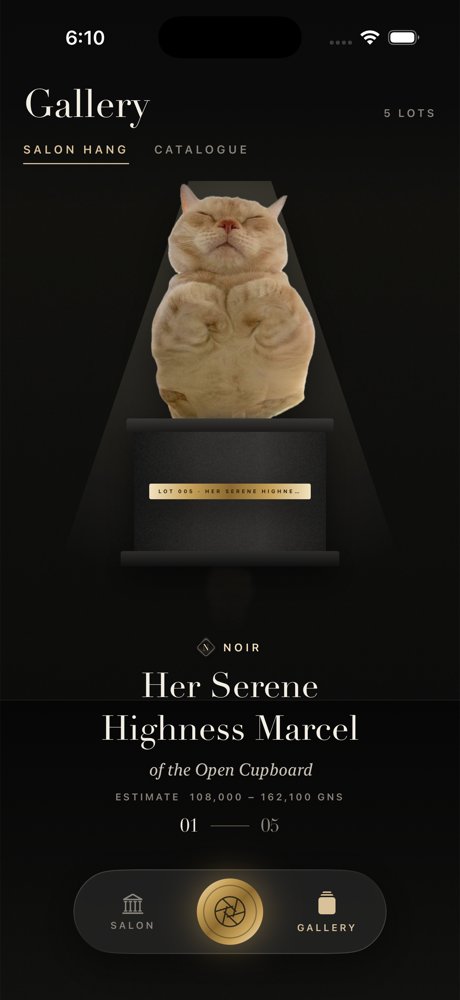
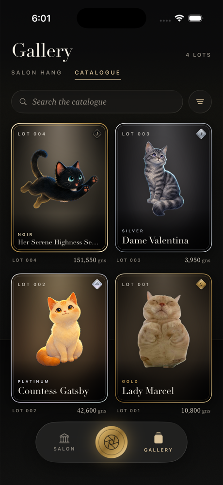

# CatDex Maison — v2

*A private collection of extraordinary cats.*

Photograph a cat. It's lifted out of the photo, its coat is read, Apple Intelligence
writes it a catalogue entry on device, and it arrives in a wax-sealed envelope as the
next lot in your collection. v2 re-imagines v1's playful card game as a luxury house:
auction catalogue, couture atelier and natural-history museum in one.

See [docs/DESIGN.md](docs/DESIGN.md) for the full concept.

| Salon | Salon Hang | Catalogue | Dossier | Certificate |
|---|---|---|---|---|
|  |  |  |  |  |

| The Lens | The Appraisal | The Unsealing | The Reveal | Audience |
|---|---|---|---|---|
|  |  |  |  |  |

## Highlights

- **The Lens** — custom AVFoundation camera; on device, Vision watches the live feed and a
  gold reticle locks onto any cat it recognises (`FELIS CATUS · 94%`).
- **The Appraisal** — a five-stage ceremony: subject lift with a gold-edged *gilded dissolve*
  (Metal), k-means coat palette named from a couture colour library, on-device scene
  reading for provenance, and the curator's note **streamed live** from Foundation Models.
- **The Unsealing** — tap the wax seal three times to crack it; the flap lifts, the card
  rises, gold leaf falls for Gold and above, and the estimate counts up in guineas.
- **Five marques** — Ivory, Silver, Gold, Platinum, Noir — each with its own metal, wax and
  foil. Nine sub-Gold lots in a row guarantee the tenth is Gold or better.
- **Salon** — *Pièce du Jour*, the brushed-metal **Patron card** (tilts with the phone),
  Patronage tiers and ten **Exhibitions** (achievements).
- **Gallery** — *Salon Hang* (each cat on a plinth under a spotlight, 3D carousel, floor
  reflection) and *Catalogue* (grid, search by name/marque/colour, sort).
- **Dossier** — breathing mesh backdrop built from the cat's coat, tilt-tracking foil,
  raised gilt initial, temperament, palette, provenance.
- **Certificate of Provenance** — procedurally engraved guilloche border, cameo, wax seal,
  curator's signature; share it as an image.
- **Audience** — write to your cat; it answers in character (on-device LLM, streamed),
  with a keyword-aware house voice where Apple Intelligence isn't available.

All AI runs on device. No network, no accounts, no third-party dependencies.

## Building

Requires Xcode 26+ (with the iOS platform installed) and [XcodeGen](https://github.com/yonaskolb/XcodeGen).

```sh
xcodegen generate
open CatDex.xcodeproj
```

To run on your iPhone: plug it in (or pair it over Wi-Fi), choose it as the run destination
in Xcode and press Run. Signing is automatic with team `4622G4R23G`; the first run on a new
phone may ask you to trust the developer under *Settings → General → VPN & Device Management*. iOS 18+ runs everything; iOS 26 adds
Liquid Glass chrome, and Apple Intelligence-capable devices get the on-device curator.

Tests:

```sh
xcodebuild test -scheme CatDex -destination 'platform=iOS Simulator,name=iPhone 17 Pro'
```

### Simulator notes

The Simulator lacks Vision's subject-lift and animal models, so photos there are framed as
an arched *cameo* instead of lifted, and authentication reads "By the curator's eye". PNGs
that already carry transparency are honoured as cutouts. On this Mac the Simulator's
Foundation Models safety guardrail also fails to load (`promptTemplateNotFound`), so the
curator and the Audience fall back to the house writer there. On a real device with Apple
Intelligence the full pipeline runs.

`scripts/make-demo-cutouts.swift` pre-lifts photos on the host Mac (where Vision works)
for seeding. DEBUG launch hooks (`SIMCTL_CHILD_<NAME>=…` with `xcrun simctl launch`):

| Env var | Effect |
|---|---|
| `RESET=1` | Wipe the collection at launch |
| `SEED_DIR=<dir>` | Seed lots from `<name>.jpg` (+ `<name>-cutout.png`) pairs |
| `SEED_MARQUES=gold,ivory,…` | Marques for seeded lots, in order |
| `AUTO_PHOTO=<path>` | Run a photo through the appraisal at launch |
| `AUTO_PRECUT=<path>` | Frame-aligned cutout to use for `AUTO_PHOTO` |
| `FORCE_MARQUE=<marque>` | Pin the marque roll |
| `FORCE_DOUBT=1` | Show the "curator hesitates" interstitial |
| `AUTO_UNSEAL=1` / `AUTO_ADD=1` | Break the seal / add the lot without taps |
| `NO_SPLASH=1` | Skip the opening wordmark |
| `OPEN=<gallery\|catalogue\|dossier\|certificate\|audience\|lens>` | Start somewhere specific |
| `SCROLL_DOWN=1` | Scroll Salon/Dossier to their lower sections |

## Architecture

SwiftUI + SwiftData, iOS 18.0+, XcodeGen. Foundation Models is weak-linked and
availability-gated; Liquid Glass falls back to materials before iOS 26. Shaders live in
`CatDex/Shaders/Maison.metal` (foil sheen, gilded dissolve, brushed metal, scan line, grain).

```
CatDex/
  App/         entry, theme tokens, router, debug hooks, demo seeder
  Models/      Acquisition (SwiftData), Marque, Swatch
  Services/    cutout, perception, palette, appraiser, curators, audience, patronage, camera, motion
  Components/  lot card, wax seal, guilloche, gold leaf, hallmark, glyph reveal
  Views/       Root, Salon, Gallery, Dossier (+ certificate, audience), Acquire (lens, appraisal, unseal)
```
