# CatDex Maison — v2

*A private collection of extraordinary cats — and a game about building it.*

Photograph a cat. It's lifted out of the photo, its coat is read, Apple Intelligence writes
it a catalogue entry on device, and it arrives in a wax-sealed envelope as the next lot in
your collection. Then put it to work: earn guineas and XP, clear daily commissions, groom
its temperament, and send it into the ring against rival collectors' cats.

See [docs/DESIGN.md](docs/DESIGN.md) for the full design and game rules.

| Salon | Shows | Match | Verdict | Gallery |
|---|---|---|---|---|
| 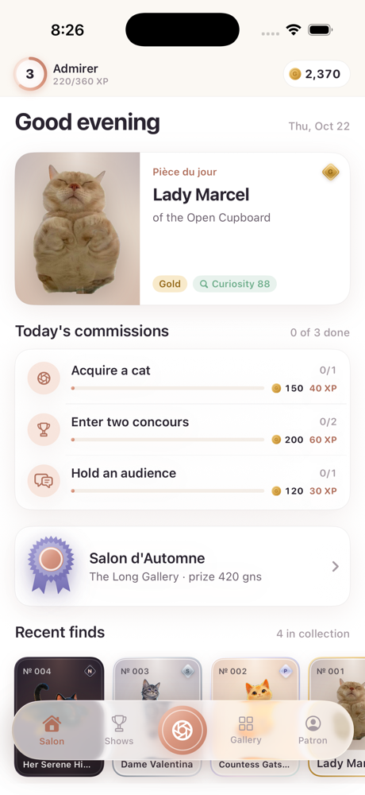 | 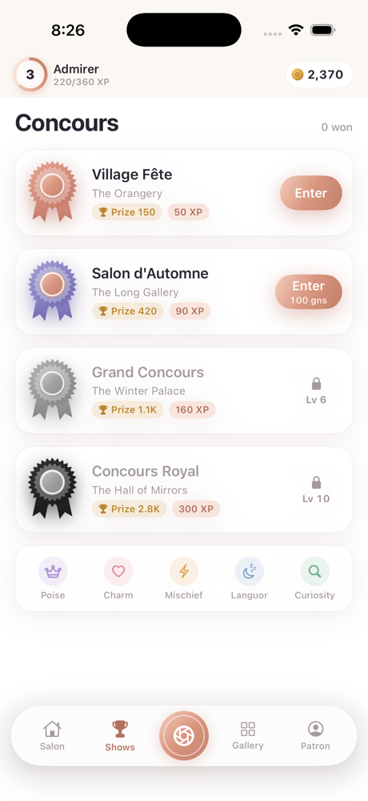 | 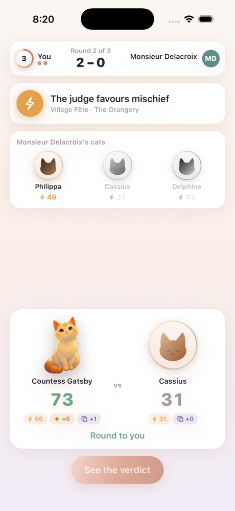 | 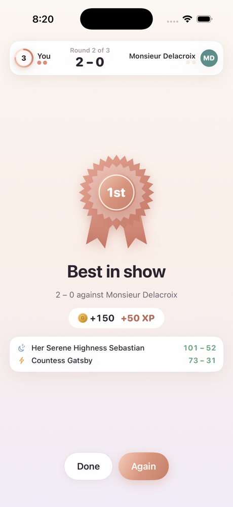 | 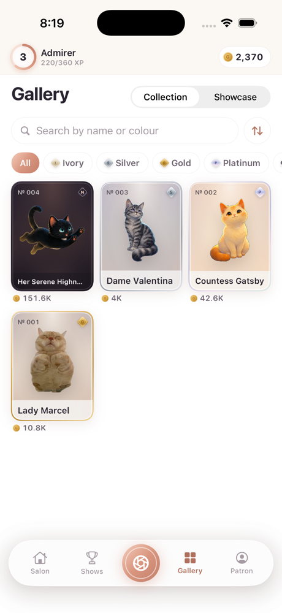 |

| Dossier | Patron | The Lens | Appraisal | Unsealing |
|---|---|---|---|---|
| 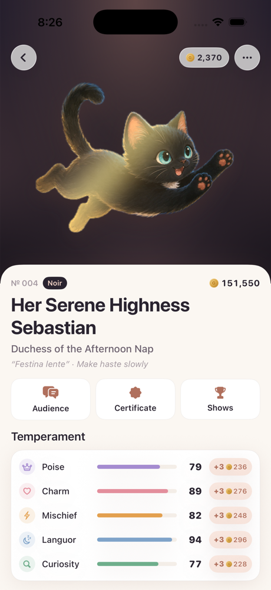 | 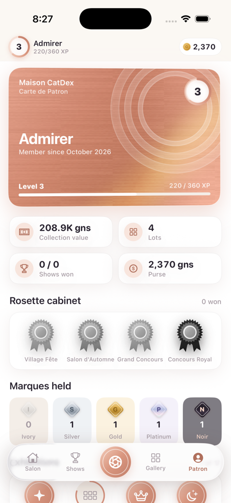 | 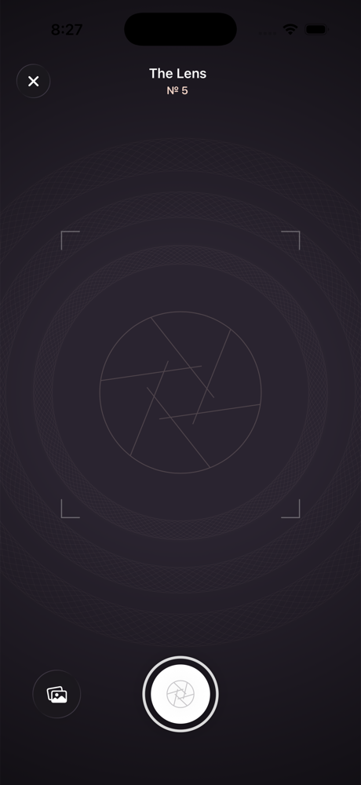 | 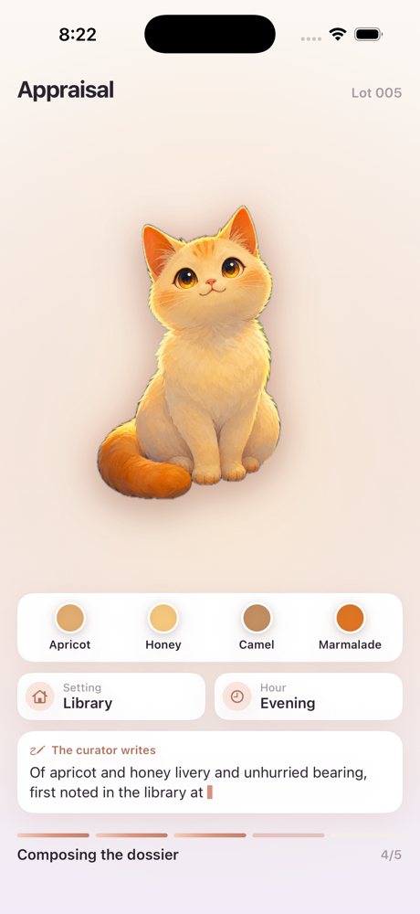 | 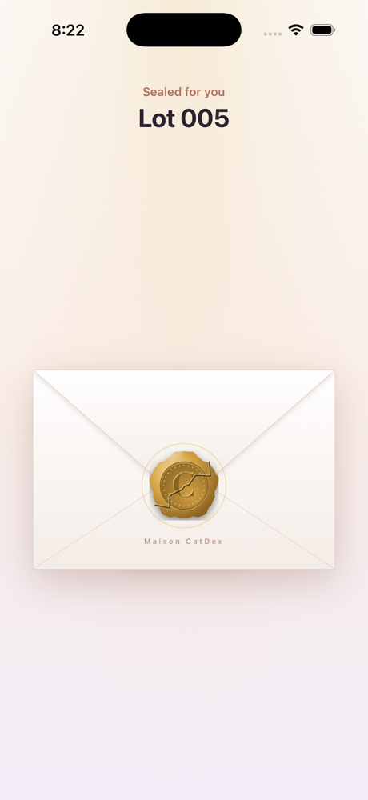 |

| Reveal | Certificate | Audience |
|---|---|---|
| 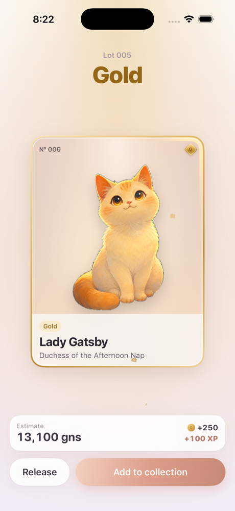 | 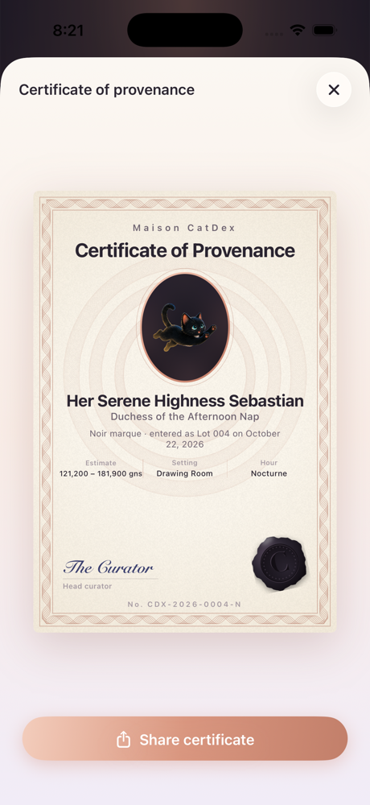 | 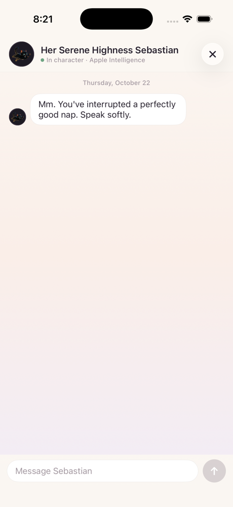 |

## Highlights

- **Pearl look** — pearl and blush grounds, rose-gold accents, SF Pro throughout, compact
  layouts; each cat's coat palette becomes its card's pastel backdrop.
- **The Lens** — custom camera; on device, a reticle locks onto any cat Vision recognises.
- **The Appraisal** — subject lift with a gold-edged dissolve (Metal), a coat palette named
  from a couture colour library, scene provenance, and the curator's note streamed live
  from Foundation Models.
- **The Unsealing** — tap the wax seal three times; the card rises with its estimate and
  the finder's fee and XP you're about to earn.
- **Five marques** — Ivory → Noir, each with its own metal, wax, foil, XP, fee and show flair.
- **Concours** — best-of-three cat shows against rival collectors across four tiers. The
  judge names a trait each round; you pick which cat to send. Win rosettes and prizes.
- **Progression** — patron levels and titles, a guinea purse, three daily commissions,
  a streak, grooming to raise traits, show experience, and ten exhibitions.
- **Patron** — rose-gold membership card, record, rosette cabinet, marques held.
- **Certificate & Audience** — a shareable certificate of provenance; chat with any cat in
  character.

All AI runs on device. No network, no accounts, no third-party dependencies.

## Building

Requires Xcode 26+ (with the iOS platform installed) and [XcodeGen](https://github.com/yonaskolb/XcodeGen).

```sh
xcodegen generate
open CatDex.xcodeproj
```

To run on your iPhone: plug it in (or pair it over Wi-Fi), choose it as the run destination
in Xcode and press Run. Signing is automatic with team `4622G4R23G`; the first run on a new
phone may ask you to trust the developer under *Settings → General → VPN & Device Management*. iOS 18+ runs everything; iOS 26 adds
Liquid Glass chrome, and Apple Intelligence-capable devices get the on-device curator.

Tests:

```sh
xcodebuild test -scheme CatDex -destination 'platform=iOS Simulator,name=iPhone 17 Pro'
```

### Simulator notes

The Simulator lacks Vision's subject-lift and animal models, so photos there are framed as
an arched *cameo* instead of lifted, and authentication reads "By the curator's eye". PNGs
that already carry transparency are honoured as cutouts. On this Mac the Simulator's
Foundation Models safety guardrail also fails to load (`promptTemplateNotFound`), so the
curator and the Audience fall back to the house writer there. On a real device with Apple
Intelligence the full pipeline runs.

`scripts/make-demo-cutouts.swift` pre-lifts photos on the host Mac (where Vision works)
for seeding. DEBUG launch hooks (`SIMCTL_CHILD_<NAME>=…` with `xcrun simctl launch`):

| Env var | Effect |
|---|---|
| `RESET=1` | Wipe the collection at launch |
| `SEED_DIR=<dir>` | Seed lots from `<name>.jpg` (+ `<name>-cutout.png`) pairs |
| `SEED_MARQUES=gold,ivory,…` | Marques for seeded lots, in order |
| `AUTO_PHOTO=<path>` | Run a photo through the appraisal at launch |
| `AUTO_PRECUT=<path>` | Frame-aligned cutout to use for `AUTO_PHOTO` |
| `FORCE_MARQUE=<marque>` | Pin the marque roll |
| `FORCE_DOUBT=1` | Show the "curator hesitates" interstitial |
| `AUTO_UNSEAL=1` / `AUTO_ADD=1` | Break the seal / add the lot without taps |
| `NO_SPLASH=1` | Skip the opening wordmark |
| `OPEN=<gallery\|hang\|concours\|match\|patron\|dossier\|groom\|certificate\|audience\|lens>` | Start somewhere specific |
| `SEED_REPEAT=<n>` | Seed each photo in `SEED_DIR` n times |
| `AUTO_MATCH=1` / `AUTO_PLAY=1` | Enter a concours with the suggested team / play every round |
| `PATRON_XP=<n>` | Set the patron's XP at launch (unlock higher tiers) |
| `SCROLL_DOWN=1` | Scroll the Dossier to its lower sections |

## Architecture

SwiftUI + SwiftData, iOS 18.0+, XcodeGen. Foundation Models is weak-linked and
availability-gated; Liquid Glass falls back to materials before iOS 26. Shaders live in
`CatDex/Shaders/Maison.metal` (foil sheen, gilded dissolve, brushed metal, scan line, grain).

```
CatDex/
  App/         entry, theme tokens, router, debug hooks, demo seeder
  Models/      Acquisition, Ledger (SwiftData), Marque, Swatch
  Services/    cutout, perception, palette, appraiser, curators, audience, camera, motion,
               game (Game, Progression, Commission, Streak, Grooming), Concours rules
  Components/  lot card, HUD, rosettes, rival busts, reward toasts, wax seal, guilloche
  Views/       Root, Salon, Concours, Gallery, Dossier (+ certificate, audience), Patron,
               Acquire (lens, appraisal, unseal)
```
